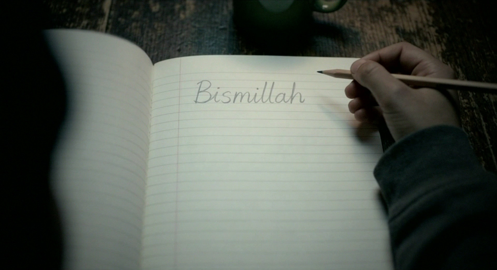
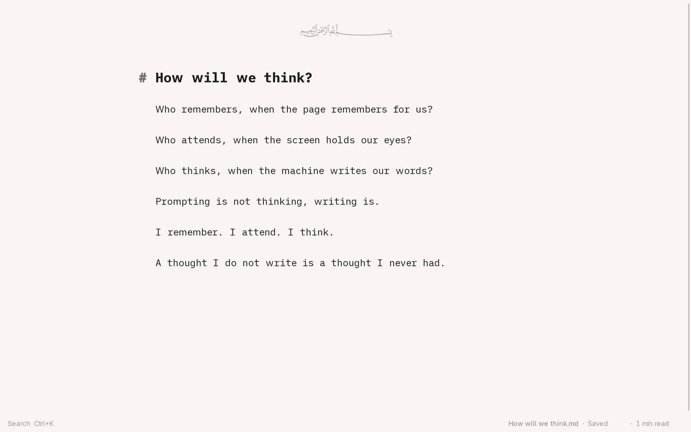
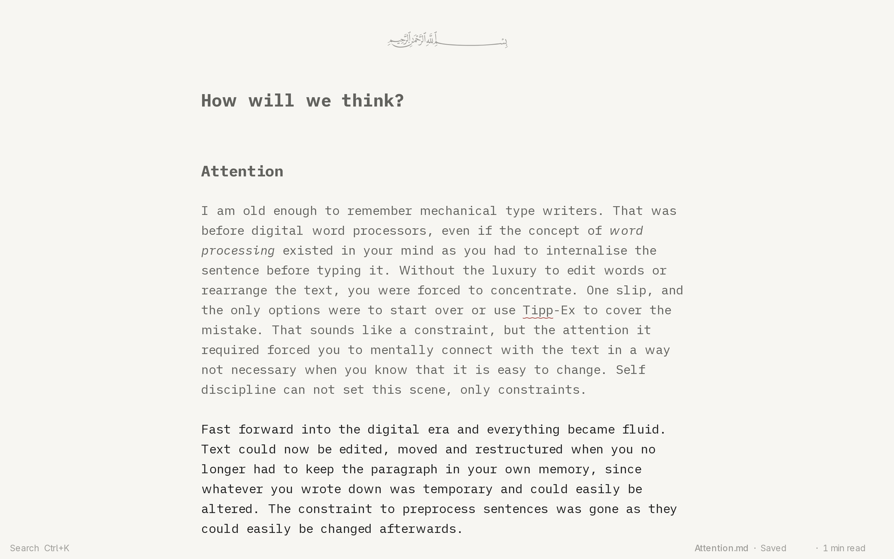
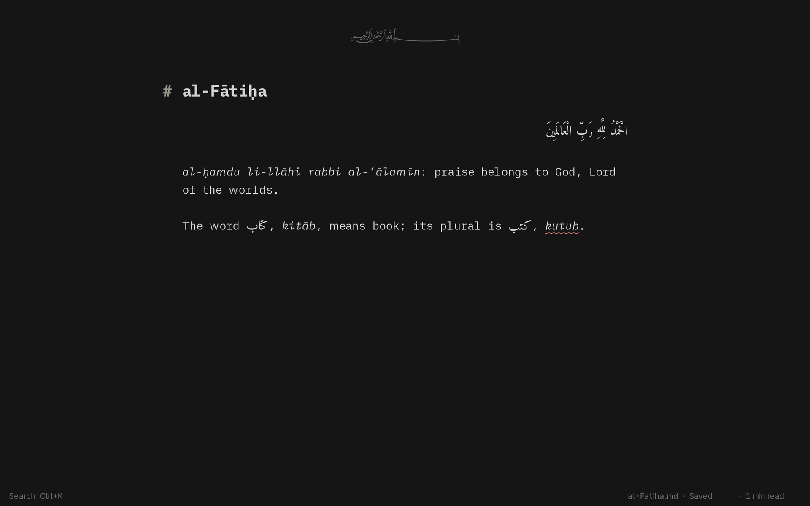
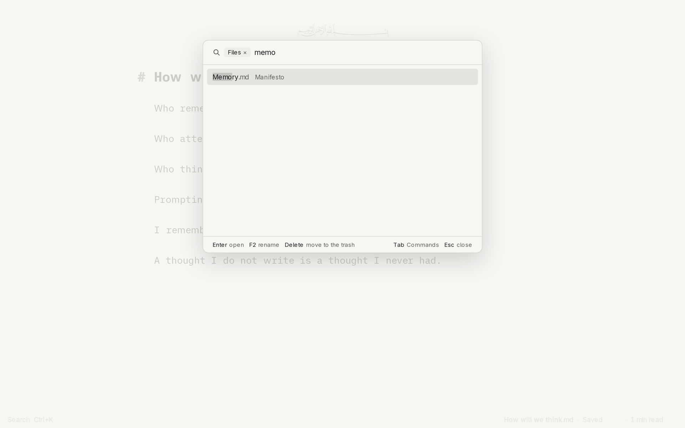
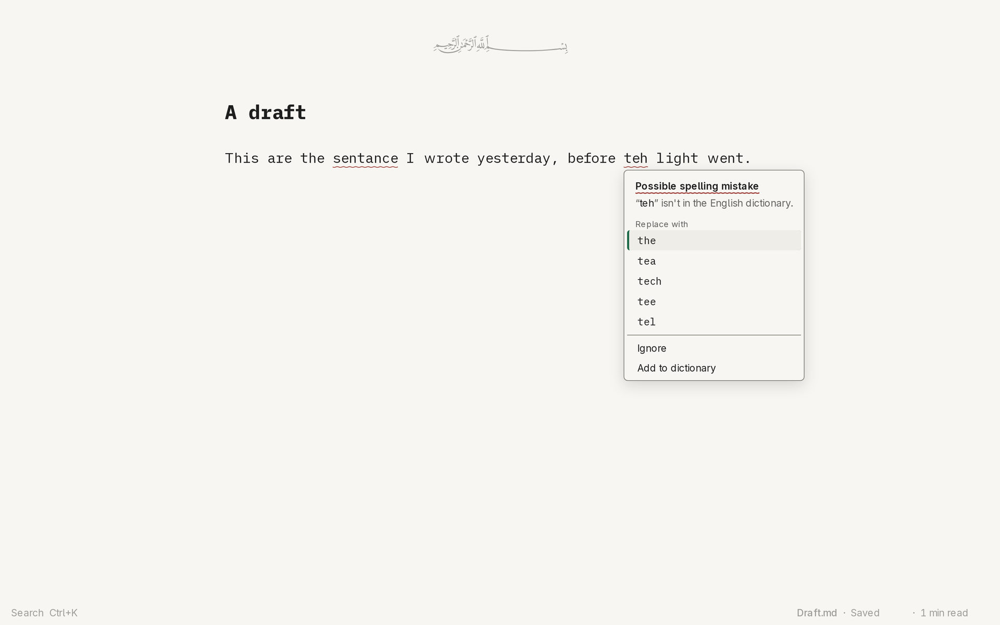

<p align="center">بِسْمِ اللَّهِ الرَّحْمَٰنِ الرَّحِيمِ</p>

<p align="center">
  <a href="https://bismillah.ink">
    
  </a>
</p>

<h3 align="center">A calm Markdown editor. Just you and your words.</h3>

<p align="center">
  A Tauri 2 desktop app, Svelte 5 and CodeMirror 6 on a Rust core,<br>
  that saves plain Markdown files and checks spelling in English and Arabic offline.
</p>

<p align="center">
  <a href="https://bismillah.ink"><b>bismillah.ink</b></a> ·
  <a href="#install">Install</a> ·
  <a href="docs/guide.md">Guide</a> ·
  <a href="PRIVACY.md">Privacy</a> ·
  <a href="#docs">Docs</a>
</p>

<p align="center">
  <a href="https://github.com/YunusAndreasson/bismillah/actions/workflows/verify.yml"></a>
  <a href="LICENSE"></a>
</p>

<br>



bismillah is a free, open-source writing app in the spirit of the original iA
Writer: a typewriter, with only the best of the computer.

## Features

- **Plain Markdown files** in a folder you choose. Filenames are the
  organisation and frontmatter is optional; there's no database, so any other
  program can open your writing.
- **Safe saving.** The status line says *Saved* only once the text is on disk.
  Text being saved also goes to a recovery copy, and a failed save stays on screen
  until it's resolved, because a writer who trusts a false *Saved* can lose work.
- **Typography first.** A bounded measure and bundled fonts. The page reads as
  rendered text, and the Markdown shows only in the paragraph you're writing (or
  everywhere, with `Ctrl+R`).
- **Spelling** in English and Arabic and **grammar suggestions** in English,
  checked on your computer. Nothing changes until you accept it.
- **Arabic and right-to-left** writing as equals to Latin. Text is saved exactly
  as typed, since one mark can change the meaning of vocalised Arabic or a quoted
  verse.
- **Zuhd mode (زهد)**, after the word for restraint: `Ctrl+D` keeps the sentence
  or paragraph you're writing clear and quietens the rest.
- **Keyboard first.** Every action has a shortcut and a place in Search
  (`Ctrl+K`), which finds files, commands and settings in one list.
- **The bismillah stick.** A USB stick that starts a PC laptop straight into
  bismillah, with no network, no other apps and your texts encrypted on it
  ([os/README.md](os/README.md)). Its image isn't published yet.

And just as deliberately, it has **no** accounts, subscriptions, ads, telemetry,
cloud sync, generative AI, or networking features. Nothing writes for you, and
links never open. See [PRIVACY.md](PRIVACY.md).

<table>
  <tr>
    <td width="50%"></td>
    <td width="50%"></td>
  </tr>
  <tr>
    <td align="center"><sub><b>Zuhd mode</b>, the paragraph you're writing</sub></td>
    <td align="center"><sub><b>Arabic and English</b>, every mark kept</sub></td>
  </tr>
  <tr>
    <td width="50%"></td>
    <td width="50%"></td>
  </tr>
  <tr>
    <td align="center"><sub><b>Search</b>, a file by four letters</sub></td>
    <td align="center"><sub><b>Spelling</b>, every change yours to make</sub></td>
  </tr>
</table>

## Install

There's no published release yet. On Arch Linux, build and install the committed
version:

```sh
cd packaging/arch && makepkg -si
```

That installs `bismillah` with its icon and desktop entry, so Markdown files offer
*Open with › bismillah*. Start it from your launcher, or with
`bismillah [file | folder]`. Some GPU and driver combinations need
`WEBKIT_DISABLE_DMABUF_RENDERER=1` in the environment. Elsewhere, run it from
source (below). A signed macOS app ([ADR-0024](docs/decisions/0024-macos-release.md)) and
the stick's download ([ADR-0017](docs/decisions/0017-published-stick.md)) are
planned.

## Development

```sh
pnpm install --frozen-lockfile
pnpm tauri dev
pnpm verify --fast
```

`pnpm verify` without `--fast` adds the build and the real-app e2e and visual
suites, and is the gate before every commit. The prerequisites are in
[CONTRIBUTING.md](CONTRIBUTING.md), and every command is in
[AGENTS.md](AGENTS.md#commands).

## Docs

- [The guide](docs/guide.md): everything bismillah does, also inside the app
  (*Help › Guide*, `F1`)
- [PRIVACY.md](PRIVACY.md): the files it keeps, and what it never does
- [DESIGN.md](DESIGN.md): principles, typography, colour, interaction
- [ARCHITECTURE.md](ARCHITECTURE.md): how it's built and the contracts it keeps
- [PLAN.md](PLAN.md) and [docs/decisions/](docs/decisions/): the roadmap and the
  decisions behind it
- [os/README.md](os/README.md): the stick, what it promises and what it doesn't
- [MANIFESTO.md](MANIFESTO.md): *How will we think?*, the essay behind it

## Inspiration

bismillah is inspired by Islamic ethics: treating the writer's words as a trust
(*amanah*), respecting privacy, and practising restraint. These shape how the app
saves, what it refuses to collect, and how little it asks of your attention. Read
more in [DESIGN.md](DESIGN.md#4-islamic-principles-as-design-constraints).

## Under the hood

- [Tauri 2](https://v2.tauri.app) on the system webview (WebKitGTK on Linux)
- [Svelte 5](https://svelte.dev) and [Bits UI](https://bits-ui.com) for the
  interface
- [CodeMirror 6](https://codemirror.net) for editing, input methods, bidi and undo
- [Harper](https://github.com/Automattic/harper) for English spelling and grammar
- [spellbook](https://github.com/helix-editor/spellbook) and the
  [Ayaspell](https://github.com/LibreOffice/dictionaries/tree/master/ar)
  dictionary for Arabic
- [iA Writer Duo](https://github.com/iaolo/iA-Fonts), with the IJMES letters added
  as Bismillah Duo, and [Amiri](https://github.com/aliftype/amiri) for Arabic
- For the stick, Debian 13 built with [mkosi](https://github.com/systemd/mkosi),
  [cage](https://github.com/cage-kiosk/cage), LUKS2 and dm-verity

## License

[GPL-3.0-or-later](LICENSE). The film, the website's pictures and the manifesto
are all rights reserved, and the bundled fonts and Arabic dictionary keep their
own licences: see [NOTICE.md](NOTICE.md).
