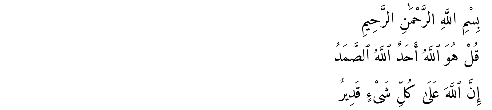
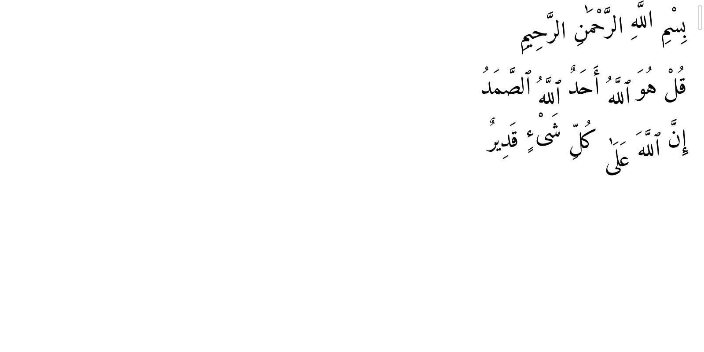

# Spike finding: WebKitGTK misplaces Arabic marks

*Phase 0, 2026-10-18, WebKitGTK 2.54.1 (Skia).* Found during the font-profile spike. **This blocks correct vocalised and Qur'anic Arabic in the editor and needs the author's decision** (proposed ADR-0011).

## What happens

| HarfBuzz (correct) | WebKitGTK 2.54 in the editor |
|---|---|
|  |  |

Lines: the Basmallah in Amiri; *qul huwa llāhu aḥad, Allāhu ṣ-ṣamad* and *inna llāha ʿalā kulli shayʾin qadīr* in Amiri Quran. In WebKit the sukun of بِسْمِ floats high, ٱللَّهُ drops, عَلَىٰ falls below the line, and marks sit at the wrong heights.

With IBM Plex Sans Arabic (Duo's planned pairing) it is far worse: kasra and kasratan are drawn *above* the letter, and inside the editor whole words jump up or down ([matrix](img/plex-white-space-matrix.png)).

## Root cause

HarfBuzz positions marks with x **and y** offsets. WebKit's Skia port draws horizontal text with `SkTextBlobBuilder::allocRunPosH` (in `FontBase::buildTextBlob`, `Source/WebCore/platform/graphics/skia/FontSkia.cpp`), which stores **x positions only**: every glyph's y offset is computed and then dropped, and only the run's starting point carries the *first* glyph's offset. So:
- marks lose their vertical offset (Plex's kasra stays where it was drawn, above the baseline);
- when preserved whitespace splits text into one run per word (`white-space: pre`, `pre-wrap`, `break-spaces`, all of which an editor needs), a word whose first visual glyph is a mark shifts by that mark's offset.

Measured precisely: for لِلَّهِ in Amiri the first glyph is the kasra (+181 units), so WebKit raises the whole word by 7px at 40px and drops the shadda/fatha offsets (−164, −215); the predicted ink heights match WebKit's to 0.6px. This is WebKit bug [255972](https://bugs.webkit.org/show_bug.cgi?id=255972) (open since 2023, root cause not identified there; reporters list Noto Naskh, Mada, Reem Kufi and others). The fix upstream is small: use full (x, y) positions (`allocRunPos`) when any advance has a height.

## Measured on the bundled fonts

The spike's check (now `tests/visual/arabic-rendering.visual.ts` in `pnpm test:visual`, with the HarfBuzz reference generated by `tests/visual/tools/arabic_reference.py`) renders all 237 vocalised words of the specimen and the Qur'an fixtures in the webview with `white-space: pre-wrap` and compares each word's ink top and bottom with HarfBuzz and the font's own glyph bounds. Error = largest edge difference, in em.

| Font | Words off by > 0.08 em | Median | p90 | Max | Worst words |
|---|---:|---:|---:|---:|---|
| IBM Plex Sans Arabic | 216 / 237 | 0.22 | 0.65 | 1.09 | الْقَوْلِ, غَيْرِ, لِلَّهِ |
| Amiri | 44 / 237 | 0.01 | 0.12 | 0.78 | عَلَىٰ, ٱللَّهُ, لِلَّهِ |
| Amiri Quran | 39 / 237 | 0.02 | 0.11 | 0.65 | عَلَىٰ, ٱللَّهَ, لِلَّهِ |

Amiri positions most marks in the glyph design and needs fewer y offsets (7.5% of glyphs, against Plex's 33%), so most words are exact. But the errors fall on the most frequent words in Qur'anic quotation (Allāh).

## Interim state

All profiles pair with Amiri (`src/styles/profiles.css`), which renders most text correctly; Plex Sans Arabic is unused until the bug is fixed. The rendering check above should run on every WebKitGTK update.

## Options (for ADR-0011)

1. **Upstream fix.** Report the root cause and the patch on bug 255972 (an outward action: the author's call). Lowest cost; timing depends on WebKit releases.
2. **Locally patched WebKitGTK** (Arch `webkit2gtk-4.1` PKGBUILD plus the patch). Correct immediately on this machine; a multi-hour build after every WebKitGTK update until upstream ships the fix.
3. **Font engineering:** rebuild Amiri/Amiri Quran so marks need no y offsets (GSUB-selected, pre-shifted mark glyphs). Works on any WebKit, but it is substantial, risky work on shaping tables.
4. **Render the Basmallah opening as pre-shaped outlines** (SVG built from HarfBuzz, with the real text kept for selection and screen readers). Fixes only the Basmallah, cheaply; editable text still needs 1–3.
5. **Revisit the engine** (ADR-0001): Chromium renders this correctly, but Tauri has no stable Chromium backend on Linux; Electron would reverse ADR-0001.
6. **Accept** the residual errors with Amiri until upstream fixes it.

Recommendation: 1 now, 4 for the Basmallah in Phase 1, and decide between 2 and 6 after seeing the errors in daily writing; keep 3 in reserve.
