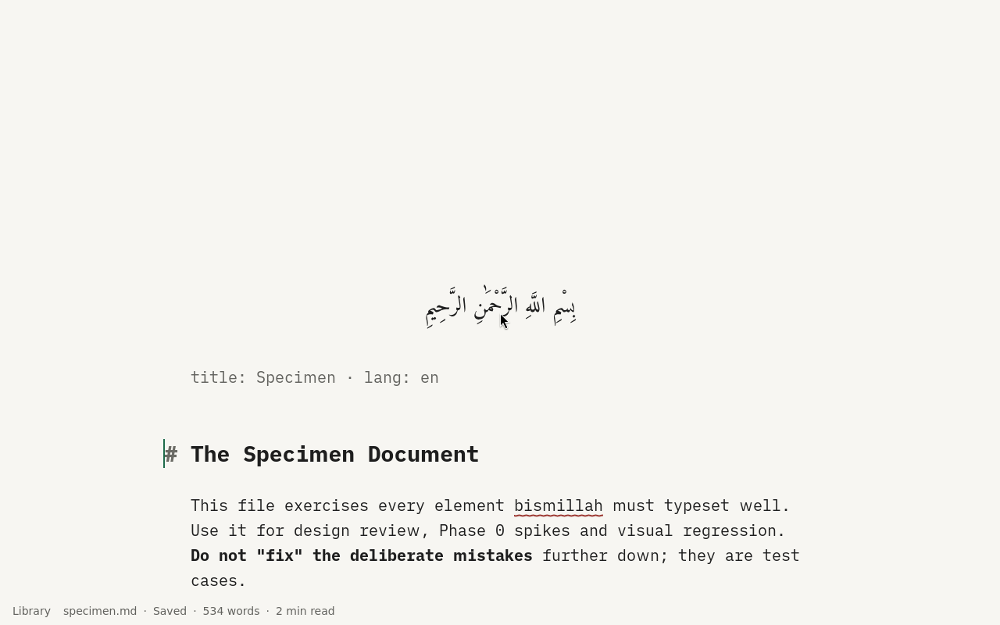
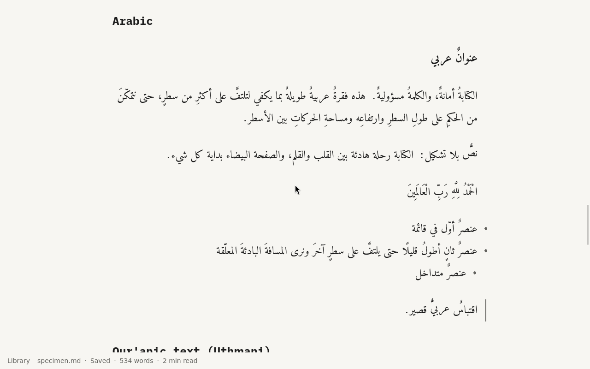
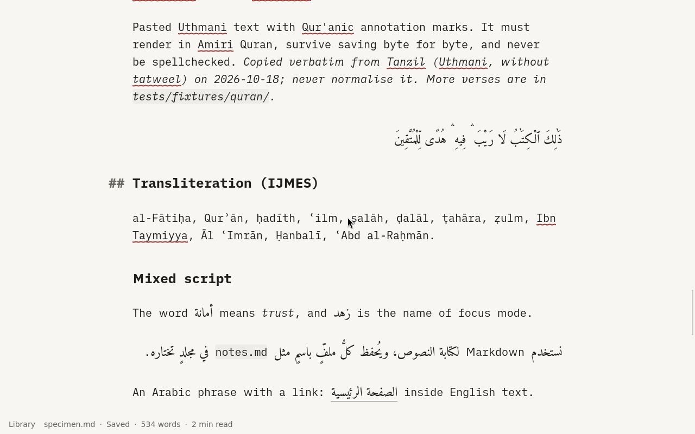

# OS-0 spike: the app on Debian

**Question** (os/PLAN.md, OS-0): does bismillah, built in the Debian 13 container, run under cage with trixie's WebKitGTK? Rendering, the specimen, dialogs, clipboard, the WebKit sandbox, and WebKit's network process with no interfaces.

**Verdict so far: go for building and rendering.** The rest of the checklist is open.

## Setup

- `os/build/Containerfile` and `os/build/build-app.sh`: Debian 13 plus trixie-security (`libwebkit2gtk-4.1-dev` 2.54.0-1~deb13u2), Rust 1.99.0 (rustup), Node 26.12.0, pnpm 11.2.2. The script builds the committed HEAD from a clone, with the repository mounted read-only. Release build in 4 min; the binary is 38 MB.
- The spike image's `app` profile (`mkosi --profile=app`) adds cage, the WebKitGTK and GTK runtime libraries, Mesa, bubblewrap, xdg-dbus-proxy and one UI font (DejaVu), and `wlr-randr`. It also adds:
  - `/usr/libexec/bismillah-session`, run by cage: scales outputs of at least 192 dpi to 2× (the Dell's 4K panel showed tiny text at 1×), then starts the app.
  - `/etc/gtk-3.0/settings.ini` preferring dark, so the app (which follows the system scheme) opens dark.
  - a `writer` user (sysusers.d)
  - `/var` and `/home` in RAM
  - `bismillah-session.service`: `User=writer`, `PAMName=login`, tty1, `cage -d -- bismillah-session bismillah ~/Texts/specimen.md`
- VM: as in the signed-boot spike (Secure Boot on, both CAs), plus `virtio-vga`, no virgl. Screenshots are taken with QMP `screendump` and keys sent with `input-send-event` (`os/spikes/boot/qmp.py`).

## Results

- **It boots to the editor with Secure Boot on.** The app opens the specimen, and the session runs as `writer` under cage.
- **Rendering:** ﷽ opening, frontmatter line, headings, lists, quotes, code block, table and footnote all render, along with these lines:
  - Arabic: RTL headings, vocalised paragraphs, RTL list markers and the quote bar on the right
  - Uthmani in Amiri Quran
  - IJMES transliteration
  - mixed lines with inline code and an Arabic link
  - spelling underlines (English).
  
  The ADR-0011 Arabic mark placement looks the same as on the desktop (expected: the same WebKit version, unpatched).
    
- **GPU:** in the VM, Mesa falls back to `kms_swrast` (no virgl), which works. Real GPUs are the *GPU and display* spike.
- **Errors:** the console shows no WebKit, GTK or sandbox errors. Only EGL's DRI2 warnings appear before the software fallback.

## Still open

- Pixel comparison with the Arch visual baselines (needs the visual harness, or matching screenshots, inside the VM).
- GTK dialogs centred by cage, the clipboard, and checks that the WebKit sandbox (bwrap) is actually active and that the network process runs with no interfaces. These need a guest shell: the debug profile's serial root shell (OS-1) or a socket serial.
- The image isn't trimmed (1.4 GB raw), by choice: make it work first.
