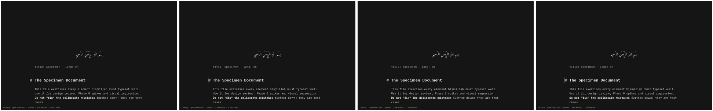

# OS-0 spike: GPU and display

**Question** (os/PLAN.md, OS-0):
- Is cage on the real GPU driver without races? Specifically:
  - no simpledrm handover
  - waiting for the boot-VGA DRM device
  - `WLR_DRM_DEVICES` on hybrids such as the Dell's Intel + NVIDIA
- Is llvmpipe usable as a fallback (`WEBKIT_DISABLE_COMPOSITING_MODE`)?
- What do the declared GPU families add in modules and firmware: Intel i915/xe, AMD amdgpu, NVIDIA-only nouveau, and virtio-gpu?

**Verdict: go in the VM; the Dell part is pending.** cage waits for the boot display and uses only that one, and the app renders on every display setup tried. The fallback to software rendering works without any setting. The Dell check covers the rest: i915 rendering, the NVIDIA card left idle and powered down, and WebKit's own GPU choice (`os/spikes/boot/DELL-CHECK.md`).

## Setup

- **`gpu` image profile** (`os/spikes/boot/mkosi.profiles/gpu/`):
  - Debian's `firmware-intel-graphics`, `firmware-amd-graphics` and `firmware-nvidia-graphics` (non-free-firmware).
  - A udev rule that names the display the firmware booted on `/dev/dri/boot-vga`, tagged for systemd.
  - A session drop-in (`v-gpu.conf`, ordered after the unlock profile's): `Wants=`/`After=dev-dri-boot\x2dvga.device` and `WLR_DRM_DEVICES=/dev/dri/boot-vga`.
- **Image:** `mkosi --profile=app --profile=nonet --profile=probe --profile=gpu`. The session logs Mesa's loader at `EGL_LOG_LEVEL=debug`.
- **Run:** `os/spikes/boot/gpu-test.sh <vars> <out> <image> <case>` boots one display setup. It screenshots the document, then asks the guest about the PCI display devices, DRM cards, `boot_vga`, and each process's open `/dev/dri` files and DRM fdinfo.

## Results

| Case | Display setup | cage | WebKit's web process | Rendering | Screenshot |
|---|---|---|---|---|---|
| virtio | virtio-vga, no 3D | card0 | card0 | software: Mesa `kms_swrast` (llvmpipe) | the specimen |
| virgl | virtio-vga-gl, host GPU (egl-headless) | card0 + renderD128 | renderD128 | **hardware**: Mesa `virtio_gpu` (virgl) for cage, the app and WebKit | none: QEMU's egl-headless can't screendump |
| std | QEMU standard VGA (bochs-drm, no render node) | card0 | none | cage: wlroots' **pixman** renderer; WebKit: software | the specimen |
| std-nocomp | std, `WEBKIT_DISABLE_COMPOSITING_MODE=1` | card0 | none | as std, without WebKit's compositor | the specimen, identical |
| hybrid | standard VGA (boot) + virtio-gpu beside it | **card1** only (the boot display) | **card0**, the *other* GPU | as std | the specimen |
| hybrid-pin | virtio-gpu + virtio-vga (boot) | card1 | card1, before and after pinning to `boot-vga-render` | as virtio | blank after the pinned restart (finding 3) |

Evidence: `os/spikes/boot/results/gpu-display.txt`.

## Findings

1. **No simpledrm, so no handover race.** Debian's 6.12 has `efifb` (fbdev, `=y`) and `SYSFB`, but no simpledrm. Until the real driver binds there's no DRM device at all, and the driver then takes over the console from efifb. cage needs a DRM device, so it must wait. The udev alias `/dev/dri/boot-vga` with `TAG+="systemd"` gives the session a device unit to wait for. The Dell matters most here: with the small initrd (*Size and boot baseline*) the GPU driver loads after switch-root.
2. **`card0` isn't the boot display.** With two GPUs, the boot display came up as `card1`. `WLR_DRM_DEVICES=/dev/dri/boot-vga` kept cage on it, and on the Dell it keeps the NVIDIA card closed.
3. **WebKit picks a GPU of its own, and pinning it backfired.** With the boot display unable to render (bochs has no render node), WebKit's web process opened the other GPU. When the boot GPU could render, WebKit used it.
   - **The variable exists:** WebKitGTK reads `WEBKIT_WEB_RENDER_DEVICE_FILE` (found in the library's strings).
   - **Pinned to a missing node** (std VGA): the app quietly lost its dark default.
   - **Pinned to a valid node** under software rendering: the window stayed blank.
   - **So it isn't pinned.** The Dell check shows what WebKit picks on the real hybrid. If it opens the NVIDIA card, OS-1 investigates WebKit's device choice there.
   - **The `boot-vga-render` udev alias stays,** for that investigation.
4. **The software fallback needs no setting.** With no 3D, Mesa falls back to `kms_swrast`/llvmpipe for the app and WebKit. wlroots refuses llvmpipe for itself ("Software rendering detected") and uses its pixman renderer. The specimen rendered the same either way. `WEBKIT_DISABLE_COMPOSITING_MODE=1` also rendered identically, so it stays a documented escape hatch for a GPU that renders wrongly, not a default.
5. **The real GPU path works:** with virgl, cage, the app and WebKit all opened the render node and used Mesa's `virtio_gpu` driver.
6. **Hybrids need nouveau loaded.** On a hybrid, nouveau is what runtime-suspends the NVIDIA card. Without a driver, the card stays powered and drains the battery. So nouveau stays in the image even on Intel + NVIDIA laptops, and cage leaves the card closed (finding 2). Measure it on the Dell.

## What each family adds

`os/spikes/boot/gpu-sizes.py` on the GPU image's root. Module sizes are Debian's compressed `.ko.xz` files with their dependency closure. Firmware is uncompressed `.bin`, as Debian ships it.

| Family | Own modules | Shared DRM modules | Firmware | Firmware, zstd -19 |
|---|---|---|---|---|
| Intel i915 | 1.5 MiB | 0.6 MiB | 10.0 MiB | 2.1 MiB |
| Intel xe | 1.0 MiB | 0.6 MiB | 3.0 MiB | — |
| AMD amdgpu | 3.9 MiB | 0.6 MiB | 77.8 MiB | 12.4 MiB |
| AMD radeon (pre-GCN; not a declared family) | 0.6 MiB | 0.6 MiB | 3.2 MiB | — |
| NVIDIA nouveau | 0.9 MiB | 0.6 MiB | 61.6 MiB | 38.6 MiB |
| virtio-gpu | 0.1 MiB | 0.3 MiB | 0 | 0 |

- **All families together:** 8.7 MiB of modules (the image's modules total 72.6 MiB) and 155.6 MiB of firmware.
- **The firmware compresses well,** except NVIDIA's GSP images: `tu102` 24 MiB, `ga102` 37 MiB, with Ada linked to Ampere's. Debian's kernel reads zstd- and xz-compressed firmware (`FW_LOADER_COMPRESS_ZSTD`), and the root is compressed erofs anyway (*Size and boot baseline*).
- **Mesa can't be split by family** from Debian's packages. `mesa-libgallium` (40.6 MiB) holds every driver in one library and pulls in `libllvm19` (123.7 MiB) and `libz3` (26.5 MiB) for llvmpipe and radeonsi.

The Mesa trims are for later:
- **Our own Mesa build:** iris, radeonsi, nouveau, virgl, and softpipe or llvmpipe.
- **Dropping LLVM:** this costs llvmpipe and radeonsi's LLVM path; radeonsi uses ACO by default.

Both belong with the WebKit build that the plan already schedules after 1.0.

## For OS-1

- Ship the `boot-vga` alias, the session's wait and `WLR_DRM_DEVICES`. Leave `WEBKIT_WEB_RENDER_DEVICE_FILE` unset until the Dell shows it's needed.
- Keep `EGL_LOG_LEVEL` out of release.
- The VM harness gains the hybrid and std cases. virgl needs `-display egl-headless`, which has no screenshots.

## Not covered here

The Dell. Its check covers:
- which driver and device cage, the app and WebKit use (fdinfo shows i915's render engine time)
- the NVIDIA card's runtime power state
- firmware load messages
- the 2× scale on the 4K panel

AMD and newer NVIDIA hardware are untested; they go into the compatibility list as machines turn up.
