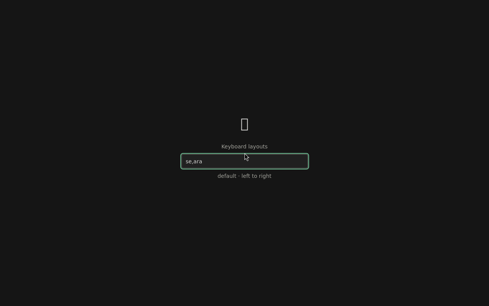
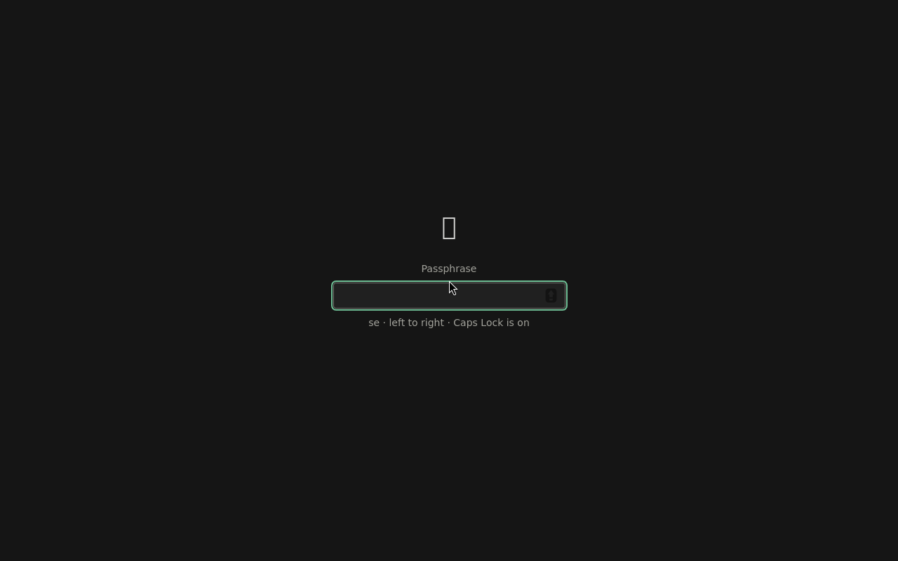

# OS-0 spike: keyboard

**Question** (os/PLAN.md, OS-0): under cage, are XKB layouts from `XKB_DEFAULT_LAYOUT`/`_OPTIONS` (e.g. `se,ara`, a switch key) read from the LUKS2 token before unlock? Are changes applied by restarting the session (cage has no runtime keymap IPC)? Is a passphrase typed in Swedish and Arabic layouts identical at setup, unlock and the suspend lock? Is the active layout or direction readable for the indicator?

**Verdict: go, cage with a session restart.** Each question is answered yes in a VM round trip typed through QMP (Secure Boot on, 2026-10-21):
- The layouts come from the LUKS2 token before unlock.
- A change takes effect after a 1.6 s session restart.
- A mixed Swedish/Arabic passphrase is accepted at setup, at the lock and at the next boot's unlock. The host confirmed its exact UTF-8 bytes against the LUKS header.
- GTK reports the direction and Caps Lock live, and the layout with each key press.

The sway fallback isn't needed.

## Setup

Built on the unlock spike ([os-unlock-in-app.md](os-unlock-in-app.md)): the same image profile and branch `spike/os-unlock`.

- **Token:** the helper's `set_keyboard` verb stores `{"type":"bismillah-keyboard","keyslots":[],"layouts":"se,ara","options":"grp:alt_shift_toggle"}` as LUKS2 token 0 (`cryptsetup token import --token-replace`). On a stick without LUKS yet, the choice waits in `/run/bismillah/keyboard.pending` (root only, RAM), and `setup` imports it right after `luksFormat`.
- **Before cage:** the session's `ExecStartPre=+/usr/libexec/bismillah-keyboard-env` runs as root. It reads the token (`cryptsetup token export`, no passphrase needed) or the pending choice, and writes `/run/bismillah/keyboard.env`. The session loads that with `EnvironmentFile=`, so cage starts with `XKB_DEFAULT_LAYOUT`/`XKB_DEFAULT_OPTIONS`.
- **Change:** the app's `spike_set_keyboard` asks the helper to store the layouts, then exits with 76. systemd restarts the session, and cage reads the new environment.
- **Indicator:** `src-tauri/src/spike_keyboard.rs`. The GTK toplevel's `key-press-event` gives the layout group of each key. `gdk::Keymap` gives the direction and Caps Lock, and its `state-changed` signal fires on every modifier or group change. Both are emitted to the page as `spike-keyboard` events.
- **Lock:** Ctrl+Alt+L shows the same screen in lock mode, and the helper's `verify` verb checks the passphrase with `cryptsetup open --test-passphrase`.
- **Run:** `os/spikes/boot/keyboard-test.sh`.
  1. Setup boot: choose `se,ara`, then set the passphrase å ä ö (Swedish), Alt+Shift, ب ل ا (Arabic, keys `f g h`), Alt+Shift, 7. Lock and unlock with the same keys.
  2. Host check: the stick's LUKS header (`luksDump`, `--test-passphrase` with the expected string).
  3. Unlock boot: Caps Lock on and off, then the same passphrase.
  
  Marks: `os/spikes/boot/results/keyboard-marks.txt`. For diagnostics they include each key's group number, never the key.

## Results

| Check | Result |
|---|---|
| First boot, no token | `SPIKE keyboard: default (none)`: cage's default layout, and the screen asks for layouts first |
| Layouts chosen → session restarted → passphrase screen | 1.58 s (exit 76 at 12.48 → screen at 14.06), including the cage restart |
| Unlock boot: layouts before unlock | `se,ara grp:alt_shift_toggle (token)` at 6.79 s, before the app starts (8.63 s) |
| Token in the header | `luksDump`: `0: bismillah-keyboard`. It is readable without the passphrase, and holds only the layout names and options |
| Setup → lock → next boot's unlock | All accepted. Lock `verify` took 1.54 s; unlock was 1.68 s from Enter to caret (1.70 s in the unlock spike) |
| Exact bytes | The host's `--test-passphrase` matches `c3 a5 c3 a4 c3 b6 d8 a8 d9 84 d8 a7 37`, i.e. `åäöبلا7` |
| Key-event group | 0 for å ä ö and 7, 1 for the three Arabic keys. Alt+Shift's own key events report the old group |
| Direction | Switches to right-to-left when Alt+Shift switches the group, before any further key |
| Caps Lock | Shown live ("Caps Lock is on"); WebKit adds its own Caps Lock icon in the password field |

 

## Findings for OS-2

1. **cage + session restart is enough.** A layout change is rare, in Settings, and costs 1.6 s. Home stays mounted across the restart, and the restarted app finds it unlocked (the unlock spike's gate). Settings should say the screen will reload briefly.
2. **The indicator can't name the layout until a key is pressed.** GDK3 doesn't expose the active group, only each key event's group. Direction and Caps Lock update immediately. Options for OS-2:
   - show the direction until the next key press
   - read the group from libxkbcommon's state of the `wl_keyboard`
   - show the layout only for two layouts with the same direction (e.g. `se,us`), where direction alone is ambiguous.
3. **Two layouts with the same direction** (e.g. `se,us`) give the indicator nothing until a key is pressed, so the second or third option in finding 2 matters for such writers.
4. **First boot needs a layout step before the passphrase,** because cage only reads layouts at start. Setup must ask for layouts, restart, then ask for the passphrase. The spike shows that order works.
5. **WebKit's password field adds a Caps Lock icon.** Our indicator duplicates it; the real Unlock view should pick one.
6. **Screenshots lag the marks.** A `screendump` 1 s after a key can show the previous frame (virtio-vga with Mesa's software rendering in the VM). Assert on marks, and screenshot only after the page has settled.
7. **VM harness:** the host disk is encrypted, so copying a 2 GB image just before a boot sometimes stalled OVMF before it started the stick. The driver now syncs after the copy and retries once if `BdsDxe: starting` doesn't appear within 40 s.

## Not covered here

- A real Swedish keyboard on the Dell.
- Layout variants and more than two layouts.
- Changing the layouts after setup: the `--token-replace` path, which is implemented but not exercised by the test.
- The suspend path itself (*Suspend lock fallback*). Here the lock is shown by a shortcut.
