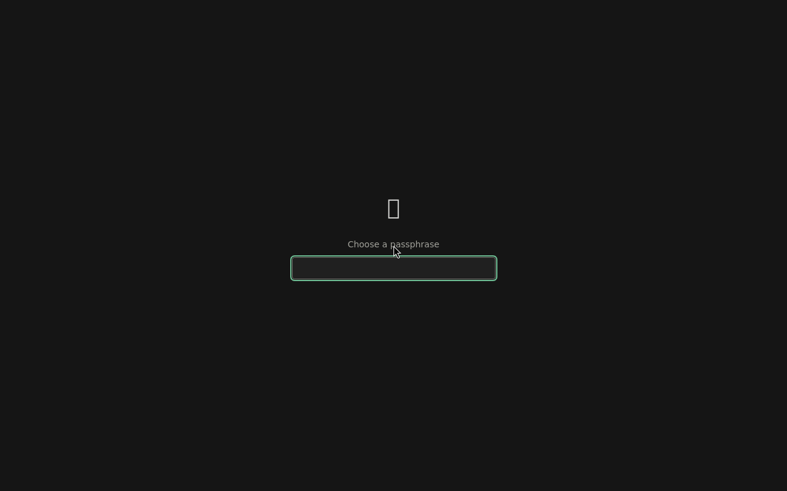
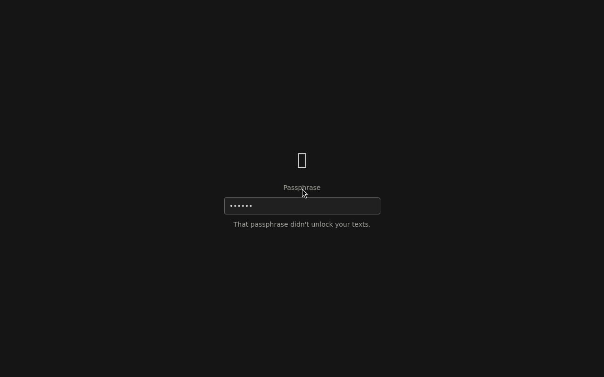
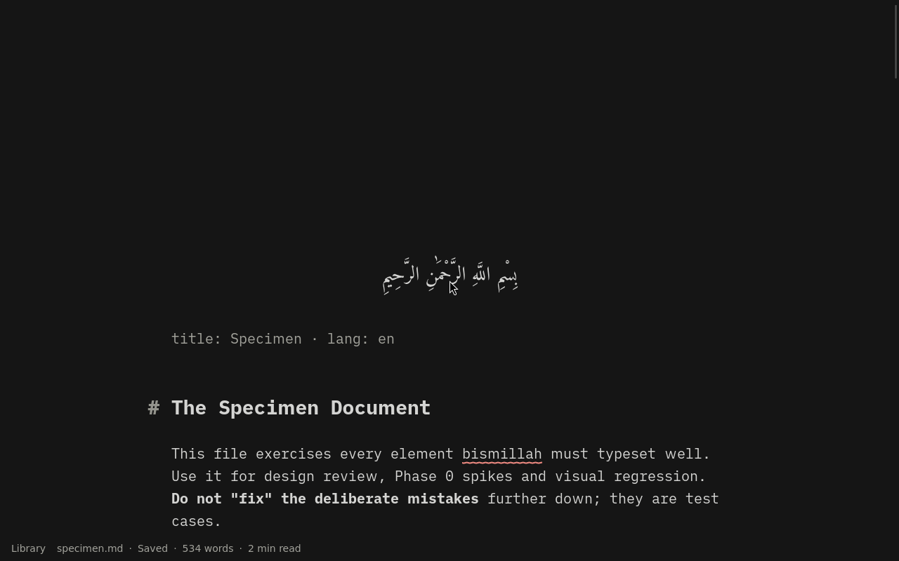

# OS-0 spike: unlock in the app

**Question** (os/PLAN.md, OS-0): the app starts before the data partition exists. Can the helper open LUKS2, mount it and hand over, so the app continues *in-process* to the last document? Compare with restarting the app after unlock.

**Verdict: go, in-process.** The app starts with home locked, shows its passphrase screen, and after the helper's answer continues in the same process to the last document in 0.19 s. Restarting the app instead costs 0.85 s, which misses the ≤ 0.5 s bar. *Unlock* pressed → caret in the last document took **1.70 s**, inside the 2.0 s budget. Measured in the VM with Secure Boot on (2026-10-20); the Dell isn't measured yet.

## Setup

- **App:** built by `os/build/build-app.sh <out>` from main. The spike code was first kept on a branch (`spike/os-unlock`) and merged into main on 2026-10-21 so that the OS builds the current editor. It runs only when the `BISMILLAH_SPIKE_*` variables are set:
  - `src-tauri/src/spike_unlock.rs`. With `BISMILLAH_SPIKE_UNLOCK=<helper socket>`, `setup` defers everything that reads home behind a `Gate`: `app::dirs`, `AppState::new` (state.json, settings, recovery, dictionary), `restore_library`, `watch_config` and the single-instance listener. `on_window_event` tolerates the missing `AppState`. The commands are `spike_gate` (the helper's state), `spike_unlock` (send the passphrase; on `ok`, run the deferred startup) and `spike_mark`.
  - `src/appliance/SpikeUnlock.svelte`, plus one `await` in `App.svelte` before `workspace.start`. The rest of the page startup is unchanged.
  - `BISMILLAH_SPIKE_RESTART=1` exits with code 75 after the unlock instead. The session launcher then starts the app again inside the same cage.
- **Image:** `mkosi --profile=app --profile=unlock` (`os/spikes/boot/mkosi.profiles/unlock/`):
  - an empty 512 MiB `home` partition (label `bismillah-home`)
  - `bismillah-helper.socket` (`/run/bismillah/helper.sock`, owned by `writer`, mode 0600, `Accept=yes`)
  - `bismillah-helper-spike`, a shell stand-in for the Rust helper. For `setup` it runs `luksFormat` (LUKS2, argon2id, `--iter-time 1000`) and `mkfs.ext4`. For `unlock` it runs `cryptsetup open`. Both then mount home at `/home/writer` (`nodev,nosuid,noatime`). The passphrase reaches cryptsetup on stdin through `printf` (a shell builtin), never on argv.
- **Run:** `os/spikes/boot/unlock-test.sh <vars> <out>` boots one persistent copy of the stick three times in OVMF (Secure Boot on, Microsoft KEK, both CAs):
  1. setup
  2. a wrong passphrase, then the right one
  3. the restart variant (`systemd.setenv=` added to the loader entry with mtools).
  
  Passphrases are typed through QMP. The marks are `BISMILLAH_MARK <name> <uptime>` on the serial port; raw lines are in `os/spikes/boot/results/unlock-marks.txt`.

## Results (seconds)

| Stage | Setup (1st boot) | Unlock | Restart variant |
|---|---|---|---|
| App process → passphrase screen | 1.25 | 1.24 | 1.27 |
| Request → helper running (socket activation) | 0.11 | 0.09 | 0.12 |
| KDF: `luksFormat` (incl. its benchmark) | 4.40 | — | — |
| KDF: `cryptsetup open` | 1.16 | 1.21 | 1.26 |
| `mkfs.ext4` (setup) / mount | 0.28 | 0.21 | 0.19 |
| Helper's answer → caret in document | **0.20** | **0.19** | **0.85** (exit, new process, gate, startup) |
| *Unlock* pressed → caret | 6.15 | **1.70** | 2.42 |

- **In-process handover works.** The unlock boot reopened `specimen.md` with no path on the command line. `state.json` was written into the encrypted home on the setup boot and read only after the unlock. The persisted library and last document arrive through the encrypted partition.
- **Wrong passphrase:** cryptsetup exits with 2, the helper answers `wrong-passphrase`, the screen says so, and the retry unlocks.

  

## Findings for OS-1/OS-2

1. **The Rust startup is the part to defer, not only the page.** `setup` reads state, settings, recovery and the dictionary, and starts two inotify watches under `$HOME`. Moving that block into a closure was ~40 lines. The product's appliance mode should keep this shape.
2. **WebKit writes under home before unlock.** These appeared in `~/.local/share/org.bismillah.editor/`, in RAM, and the mount then hid them: `storage/salt`, `CacheStorage/salt`, `hsts-storage.sqlite`, `WebKitCache/` and `mediakeys/`. fontconfig and Mesa wrote caches to `~/.cache` (moved to RAM in the spike with `XDG_CACHE_HOME=/run/user/1000/cache`). Appliance mode must set the webview's data directory to `/run/user/1000` explicitly, as the plan says. The Mesa shader cache is then cold on every boot; the *Size and boot baseline* spike should measure that cost.
3. **The GPT auto-generator acts on the home partition.** It started `systemd-growfs@home` (bit 59 set by repart) and, once home was LUKS, `systemd-cryptsetup@home` (which failed: `203/EXEC`, no binary). The helper owns home, so the product must keep systemd out: the partition's no-auto flag, or `systemd.gpt_auto=0`.
4. **Keep helper replies off the tools' stdout.** The first run's answer was cut off by cryptsetup's output on the socket. The Rust helper must never hand its socket to a child process.
5. **`serial-getty@ttyS0` hangs up the serial port** and breaks handles opened before it. The debug image's marks need their own channel, or no getty on that port.
6. **The passphrase screen runs before the app's fonts load,** so the ﷽ wordmark showed as a box. The real Unlock view must load the wordmark font first.
7. **KDF:** with `--iter-time 1000`, `open` took 1.2 s in a 2-vCPU, 2 GiB VM. Argon2id's memory cost is capped by available RAM. Setup's `luksFormat` takes 4.4 s because it benchmarks first; that is acceptable once per stick. The Dell needs its own measurement.
8. **VM harness:** a failed step left its QEMU running, and four stray VMs made later boots fail inside the firmware (shim "Verification failed", "Not Found"). `vm.ts` must always kill its VM.

## Not covered here

The Dell (timings on real hardware and a real stick), the suspend lock (*Suspend lock fallback*), keyboard layouts at unlock (*Keyboard*), finding home without a label (*Boot-device binding*), and the real Setup flow (confirmation, the no-recovery warning).
